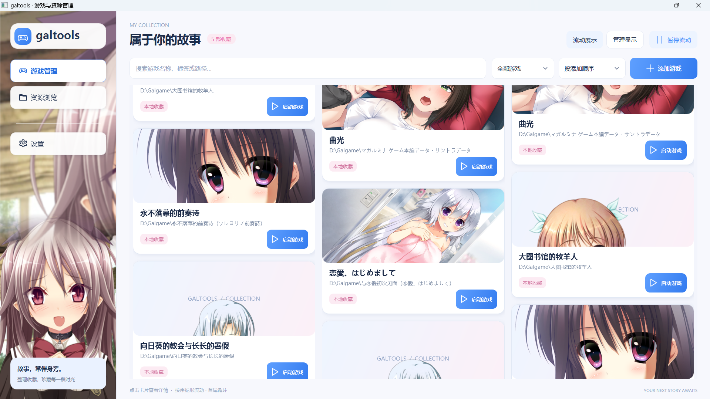
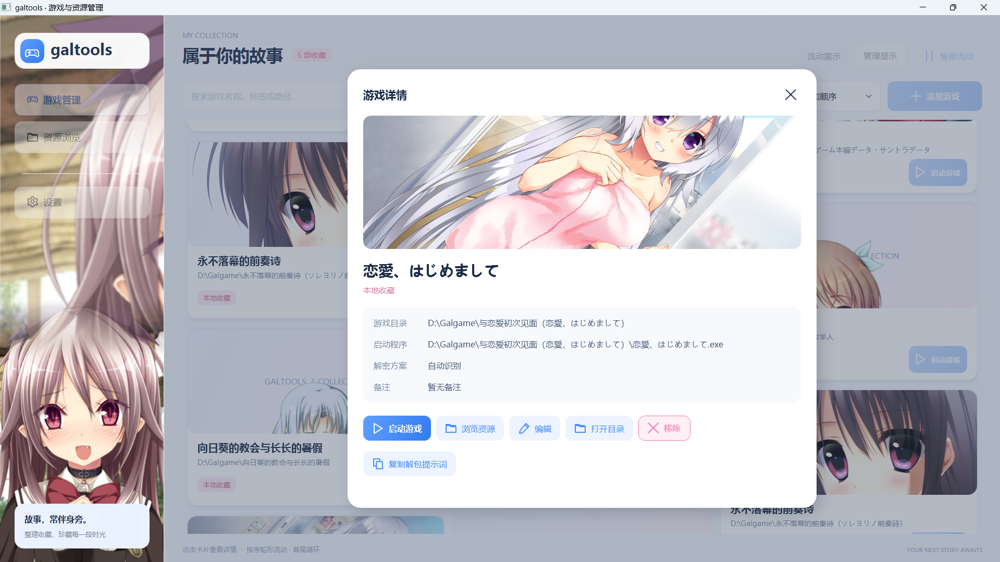
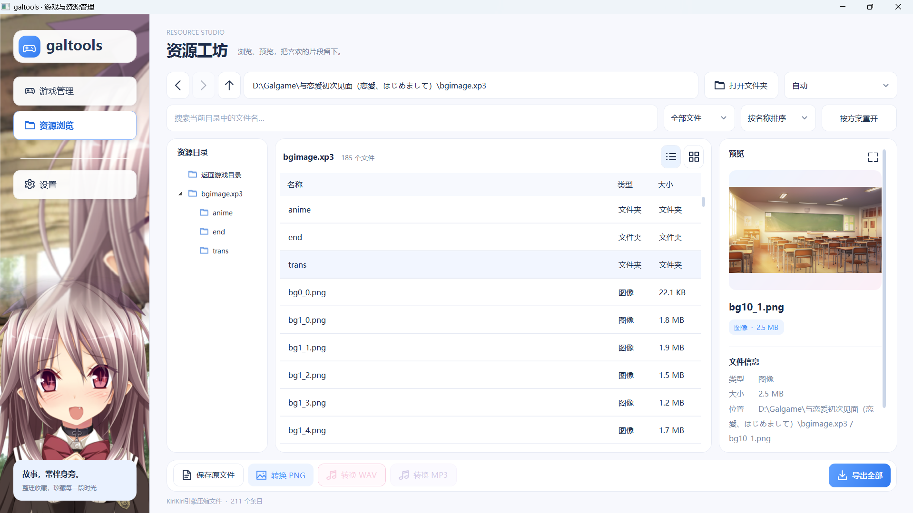

# galtools

A Windows desktop app for managing visual novels and browsing their resources. Organize your game library, open supported archives, preview assets, and export them in common formats.

Built with C# and WPF on .NET Framework 4.8. The application is under active development; its current interface is in Simplified Chinese.

## Features

- **Game library** — manage game folders, launch executables, cover images, tags, and notes.
- **Library views and appearance** — switch between a responsive flowing cover wall and a scrollable cover grid; choose light or dark colors and a rotating sidebar background.
- **Resource browser** — navigate folders and archives with back/forward history, search, filters, and list or thumbnail views.
- **Preview and conversion** — preview images, play supported audio, convert images to PNG and audio to WAV or MP3.
- **Extraction** — save individual files or export an entire archive while preserving its directory structure.
- **Extensible backends** — use the bundled GARbro-Mod engine or add a dedicated archive handler.
- **Copy an unpacking prompt** — generate a game-specific coding-harness prompt from the game details page to add in-app archive support.

Image previews are reduced to approximately 480p. PNG exports use the full decoded image. Archive compatibility depends on the format and game-specific encryption scheme; a recognized extension alone does not guarantee support.

## Simple images

### Game library

Browse your collection in a flowing cover wall, search for games, and launch them directly.



### Game details

Manage game paths and launch options, browse resources, or copy a prompt for your coding harness.



### Resource browser

Explore supported archives, preview images, and save or convert selected resources.



## Getting started

**Requirements:** Windows 10/11 x64 with .NET Framework 4.8 or later.

Run `galtools.exe` from the repository root or an extracted portable package. Keep `galtools.exe.config` and the `runtime/` directory beside it. The required archive libraries are bundled; a separate GARbro installation is not needed.

1. Add a game to the library and select its launch executable.
2. Open the resource browser and choose a game folder.
3. Double-click a supported archive, then select an entry to preview or export it.

Some encrypted archives require a game scheme to be selected manually. Multi-part archives should be opened through their main file, such as `bg.paz`; accompanying parts must remain in the same directory.

The default sidebar image is bundled in `assets/sidebar-default.png`. Custom sidebar images take precedence; restoring the default background uses this bundled image.

Library data is stored locally in `data/games.xml`. Appearance settings and imported sidebar images are stored in `data/settings.xml` and `data/sidebar-backgrounds/`. The `data/` directory is excluded from Git.

### Adding support with a coding harness

In game details, click **复制解包提示词** (Copy unpacking prompt). A game name, an existing game directory, and an existing launch EXE with absolute paths are required. Paste the prompt into a coding harness that can access your local files and run development tools. It includes the game's paths, the galtools installation path, and an absolute link to the bundled [integration guide](docs/CODING-HARNESS-UNPACK.md).

The requested outcome is archive browsing and resource preview inside galtools, without a full resource export. This button only copies text; it does not call an AI service, run the harness, or create a task package. The workflow assumes access to the full galtools source, bundled runtime, and development tools, matching the development environment. Keep these available together when distributing the full toolkit. The harness checks actual tool locations and reports missing prerequisites; see the integration guide for the implementation workflow.

## Build and package

Run these commands from the repository root:

```powershell
# Build the desktop app and GARbro-Mod bridge
powershell -ExecutionPolicy Bypass -File .\scripts\build.ps1

# Also create a full release ZIP (runtime, source, scripts and documentation)
powershell -ExecutionPolicy Bypass -File .\scripts\build.ps1 -Package
```

The build uses the installed .NET Framework compiler and the bundled dependencies, without downloading packages. The full release is written to `release/galtools-full.zip`, with a SHA-256 checksum alongside it. It includes the application, runtime, source, vendored GARbro-Mod source and license, scripts, documentation, tests, and default artwork. Personal data, caches, and build intermediates are excluded.

Python, native disassemblers, the coding harness, and the Windows/.NET Framework environment are not bundled. Optional analysis scripts require local Python; native disassembly requires a suitable external tool. The packaging script also includes `tools/` if redistributable tools are added there later.

## Project structure

```text
src/
  Galtools.Desktop/         WPF interface, game library, backend adapters
  Galtools.GarbroModBridge/ Separate process hosting GARbro-Mod
  Galtools.FormatData/      Utilities for updating the format database
runtime/garbro-mod/         Bundled libraries, bridge, and Formats.dat
vendor/GARbro-Mod/          Vendored upstream source and license
scripts/                   Build, packaging, and maintenance scripts
docs/                      Design and extension documentation
tests/                     Developer smoke checks
```

The desktop app accesses archives through `IArchiveBackend`. GARbro-Mod runs in a bridge process, while the FUYINPAK handler implements the same interface directly. Existing archive formats can gain game support through scheme and key mappings in `Formats.dat`; new containers can be added as backend implementations.

See [Adding game and archive support](docs/ADDING-GAME-FORMATS.md) for the workflow and [UI design notes](docs/UI-DESIGN.md) for interface decisions. These documents are currently in Chinese.

## Credits and upstream projects

| Project                                                | Role in galtools                                                            |
| ------------------------------------------------------ | --------------------------------------------------------------------------- |
| [GARbro](https://github.com/morkt/GARbro) by morkt     | Original resource browser and format library on which GARbro-Mod is based.  |
| [GARbro-Mod](https://github.com/nanami5270/GARbro-Mod) | Bundled archive readers, image/audio decoders, and game encryption schemes. |
| [NAudio](https://github.com/naudio/NAudio)             | Audio utilities, including MP3 encoding through Windows Media Foundation.   |

GARbro-Mod is pinned to commit [`c23bd588ddfe7907150df215f8725fe25d5b41df`](https://github.com/nanami5270/GARbro-Mod/commit/c23bd588ddfe7907150df215f8725fe25d5b41df). Its source is stored under `vendor/GARbro-Mod/`, and its runtime libraries originate from the corresponding [upstream build](https://github.com/nanami5270/GARbro-Mod/actions/runs/38232032021). The bundled `Formats.dat` also includes galtools-specific mappings maintained by `scripts/update-formats.ps1`.

Third-party components retain their respective licenses. The GARbro license is preserved in [vendor/GARbro-Mod/LICENSE](vendor/GARbro-Mod/LICENSE).

## Feedback and contributions

Report bugs or request format support through this repository's Issues. Include the app version, archive format or extension, error message, and steps to reproduce. New format support should include its detection rules, required scheme data, and a brief verification result.
